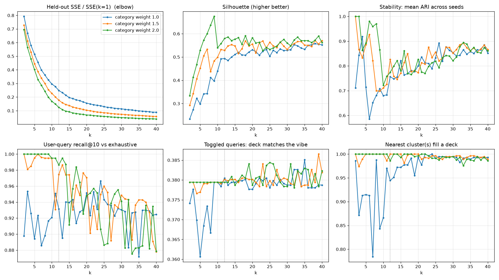

# Places k-means v1

The SideQuest v1 recommendation model. The organizer of a room sets **the borough(s), the group size and the
time**. Each person (up to 5) privately sets **their max price and one or more activity categories**, plus
optional vibes (kids, outdoors, nightlife), types or cuisines and accessibility needs. The model places those
preferences among **clusters of similar outings** and deals one **shared 10-card deck**. Every card respects
everyone's limits and is open at that time, and every member gets cards that suit them. After swiping,
`pick_winner` returns the most-liked place (`group.py`). Everything here is fitting, evaluation and offline
testing; `output/app/` is the package the app will use.

**Result:** K-means with **k = 25**, category weight 1.5, fitted on 36,352 NYC places. The model is
`output/model_v1.json` (25 centroids × 21 features). On 575 realistic user queries, it returns 9.6 of the
same top 10 places as an exhaustive search, while searching about 5.5% of the catalog. All 12 dummy user
profiles produce full decks that pass every hard filter.

## Reproduce

```bash
python3 -m venv .venv                                    # at the repository root
.venv/bin/pip install -r models/places_kmeans_v1/requirements.txt
models/places_kmeans_v1/run_all.sh                       # about 20 minutes, mostly evaluate.py
```

| Step | Script | Writes |
|---|---|---|
| 1 | `prepare.py` | `output/split.csv`, `output/feature_spec.json` |
| 2 | `sweep_k.py` | `output/sweep_metrics.csv`, `output/sweep_models/` (gitignored) |
| 3 | `evaluate.py` | `output/evaluation_metrics.csv`, `output/shortlist.csv`, `output/plots/k_selection.png` |
| 4 | `profile.py --w 1.5 --k 25 --final` | `output/model_v1.json`, `output/cluster_profiles.md/.csv`, `output/place_clusters.csv` |
| 5 | `demo_queries.py` | `output/demo_results.md/.json` |
| 6 | `category_config.py` | `output/category_filters.json`: types, filters, card fields per category |
| 6b | `group.py` | `output/group_demo.md/.json`: example rooms |
| 7 | `compare_group.py` | `output/group_comparison.csv`: group decks vs naive approaches, 500 rooms |
| 8 | `compare_baselines.py` | `output/baseline_comparison.csv`, `output/baseline_comparison_queries.csv` |
| 9 | `simulate_group_swipes.py` | `output/group_swipe_simulation*.csv` (synthetic) |
| 10 | `export_for_app.py` | `output/app/`: the package for the app |

To try your own input:

```bash
cd models/places_kmeans_v1
../../.venv/bin/python recommend.py --borough Brooklyn --max-price 2 --categories "Restaurants" --outdoors
```

The fit is deterministic: three exports of `model_v1.json` were byte-identical.

## Data

`data/places_v1.parquet` (built by `data_pipeline/build_places_v1.sql`) holds **46,195 places**:

- **45,440 Google-verified, operational places**, the **fit set**. These have price, rating, hours and vibe flags. The split is `train_test_split` on sorted `master_id`, 80/20, `random_state=42`: **36,352 train / 9,088 test**. K-means only ever sees training rows. Test places are used as held-out queries.
- **755 official city places Google didn't return**: 497 NYC Parks properties (parks, playgrounds, plazas, fields, historic houses) and 258 GreenThumb community gardens. They're trustworthy and free, but have no rating, hours or vibe flags, so they are **never used to fit**. They're added to the recommendation catalog and assigned to their nearest cluster (700 to "Free parks & outdoors", 46 to fitness, 9 to attractions). Without ratings they rank below rated parks, so they surface where rated options are thin: 70 neighborhoods have fewer than 10 rated parks.

`features.load_places(fit_only=True)` returns the fit set; the default returns the full catalog.

| Category | Places | | Price (`price_final`) | Places |
|---|---:|---|---|---:|
| Restaurants | 20,509 | | 0 free | 5,756 |
| Cafes & Desserts | 5,785 | | 1 $ | 16,245 |
| Parks & Outdoors | 3,494 | | 2 $$ | 18,791 |
| Spas & Wellness | 3,296 | | 3 $$$ | 3,644 |
| Bars & Nightlife | 2,795 | | 4 $$$$ | 1,004 |
| Shopping | 2,153 | | | |
| Attractions & Tours | 2,037 | | | |
| Sports & Fitness | 1,769 | | | |
| Museums & Galleries | 1,529 | | | |
| Shows & Live Events | 1,000 | | | |
| Libraries & Bookstores | 827 | | | |
| Games & Indoor Fun | 246 | | | |

## Features

One 21-number vector per place (`features.py`):

| Block | Columns | Value | Weight |
|---|---|---|---|
| Category | 12 | one-hot | **1.5** |
| Price | 1 | `price_final / 4` (0 free … 1 = $$$$) | 1 |
| Vibe | 8 | kids, groups, outdoor, live_music, dogs, alcohol, reservable, open_late: 1/0 from Google | 1 |

- A **missing vibe flag** takes that category's training-set mean (saved in `feature_spec.json`). Flags are known for 24–87% of places, depending on the flag.
- **Location and rating are deliberately not features.** Clusters describe the *kind of outing*. Borough is a hard filter, and rating is a ranking bonus.

## Choosing k

`sweep_k.py` fit **k = 2–40 × category weight 1.0 / 1.5 / 2.0 × 5 seeds** (585 fits). `evaluate.py` then
scored every (weight, k) on standard metrics, plus measures of how useful the model is for recommending.
It runs **648 user queries**: every borough or "any" × price 0–4 × category, plus "any" × price 1–4 ×
category × each vibe toggle. 575 of them have at least 10 matching places.

| Metric | Meaning |
|---|---|
| `sse_test_vs_k1` | held-out SSE relative to one center (elbow) |
| `silhouette`, `davies_bouldin` | how separated the clusters are |
| `ari_mean` | stability: adjusted Rand index between the 5 seeds |
| `filtered_recall10` | the cluster-based top 10 vs the exhaustive top 10, with the **same** filters and ranking, on the 575 user queries |
| `fill_rate` | the nearest cluster(s) alone give ≥10 places |
| `vibe_match` | toggled queries: share of returned places whose known flag matches the toggle |
| `proxy_recall10` | the same comparison with held-out test places as queries (no filters) |



**What the curves show:**
- **SSE falls steadily, with no sharp elbow, and silhouette plateaus around 0.55–0.59 after k≈12.** Fit metrics alone can't pick k.
- **Below k = 12, k-means merges whole categories.** w = 2.0, k = 8–9 has the best silhouette (0.64–0.67) and stability, but one cluster is "all restaurants" (45% of places). Users already choose a category, so those clusters add nothing.
- **Recall drops slowly as k grows** (1.0 at small k, about 0.87–0.94 by k = 40). This is the price of searching fewer places.
- **`vibe_match` is about 0.38 for every k, even k = 2.** Vibe matching comes from the ranking step, not the clusters.

**Selection rule** (in `evaluate.py`):

1. k ≥ 12, so clusters split categories into kinds of outing.
2. Stability ARI ≥ 0.85.
3. No cluster below 0.2% of places.
4. Then the highest `filtered_recall10`.

| w_cat | k | recall@10 | fill | clusters searched | catalog searched | silhouette | ARI | test SSE / k1 |
|---|---|---:|---:|---:|---:|---:|---:|---:|
| **1.5** | **25** | **0.960** | 0.997 | 1.29 | 5.5% | 0.563 | 0.856 | 0.085 |
| 2.0 | 16 | 0.957 | 1.000 | 1.04 | 9.1% | 0.583 | 0.861 | 0.084 |
| 1.5 | 31 | 0.944 | 0.997 | 1.49 | 5.2% | 0.548 | 0.866 | 0.072 |
| 1.5 | 32 | 0.943 | 0.997 | 1.51 | 5.1% | 0.557 | 0.885 | 0.069 |
| 1.0 | 26 | 0.937 | 0.995 | 1.28 | 5.6% | 0.529 | 0.892 | 0.124 |

Full table: `output/shortlist.csv`. w = 2.0, k = 16 is essentially tied, but coarser: its restaurants split
into 4 groups instead of 12. Profiles of the other shortlisted models are in `output/profiles/`.

## The 25 clusters

Names are generated from each profile (`profile.py`): price band + dominant category + vibes that are well
above average. Full table with examples: `output/cluster_profiles.md`.

| # | Cluster | Places |
|---|---|---:|
| 3 | Budget cafes & desserts | 4,966 |
| 0 | Free parks & outdoors · outdoor, family-friendly | 3,494 |
| 2 | Upscale spas & wellness | 3,296 |
| 1 | Mid-range restaurants · family-friendly | 3,270 |
| 4 | Mid-range bars · late-night, drinks | 2,795 |
| 15 | Budget restaurants · late-night, drinks | 2,358 |
| 7 | Mid-range shopping | 2,153 |
| 5 | Mid-range attractions · family-friendly | 2,037 |
| 11 | Budget restaurants | 2,021 |
| 23 | Mid-range restaurants · reservations, drinks | 1,921 |
| 14 | Mid-range restaurants · late-night, reservations | 1,704 |
| 19 | Mid-range sports & fitness | 1,615 |
| 24 | Budget restaurants · reservations, family-friendly | 1,606 |
| 13 | Budget restaurants · late-night, family-friendly (Chinese) | 1,591 |
| 9 | Budget museums & galleries | 1,529 |
| 6 | Mid-range restaurants · late-night, outdoor | 1,476 |
| 16 | Mid-range restaurants · outdoor, drinks | 1,369 |
| 22 | Budget restaurants · late-night, family-friendly (fast food) | 1,269 |
| 18 | Luxury restaurants · drinks, reservations | 1,244 |
| 10 | Upscale shows & live events | 1,000 |
| 12 | Budget libraries & bookstores | 827 |
| 17 | Budget cafes & desserts · late-night | 819 |
| 20 | Budget restaurants · drinks | 680 |
| 21 | Mid-range games & indoor fun | 246 |
| 8 | Mid-range sports & fitness · family-friendly | 154 |

## Decision logic (`recommend.py`)

For each selected category:

1. Build the query vector in the same 21-number space as the places.
2. Compare it with the centroids using **only what the user expressed**: the category block, price, and toggled vibes. Without this, vibes the user never mentioned would pull the query toward places with unknown attributes.
3. **Hard filters:** borough (or any), `price_final ≤ max price`, the category. A place that fails a hard filter is never shown.
4. Take the nearest cluster, plus any cluster within 0.05 of it, which counts as a tie. If fewer than 10 places pass the filters, add the next-nearest cluster.
5. **Rank** by the same distance minus 0.5 × quality. Quality is the Google rating, Bayesian-smoothed with 50 prior ratings, so a 5.0 from 3 reviews doesn't beat a 4.8 from 3,000.
6. **Diversify:** at most 3 cards per place type and one per name, so the deck isn't three branches of one chain.

Multi-category queries interleave the per-category decks.

## Dummy user inputs

These 12 profiles are made up for testing; they are not real users (`demo_queries.py`, full decks in `output/demo_results.md`).

| Profile | Nearest cluster | Clusters searched |
|---|---|---:|
| Brooklyn · $$ · Restaurants | 16 Mid-range restaurants · outdoor, drinks | 4 |
| Manhattan · Free · Museums & Galleries | 9 Budget museums & galleries | 1 |
| Queens · $ · Parks & Outdoors + kids | 0 Free parks & outdoors | 1 |
| Any · $$$ · Bars & Nightlife + nightlife | 4 Mid-range bars · late-night, drinks | 1 |
| Staten Island · $$$$ · Spas (edge case) | 2 Upscale spas & wellness | 1 |
| Manhattan · $ · Cafes + Libraries & Bookstores | 17 Budget cafes · late-night / 12 Bookstores | 3 |
| Manhattan · $$$ · Shows & Live Events | 10 Upscale shows & live events | 1 |
| Brooklyn · $$ · Games + groups | 21 Mid-range games & indoor fun | 1 |
| Bronx · $ · Restaurants + nightlife | 14 Mid-range restaurants · late-night | 3 |
| Any · $$ · Parks + Cafes + dogs, outdoors | 0 Free parks & outdoors | 3 |
| Manhattan · $$ · Attractions + Museums | 5 Mid-range attractions | 2 |
| Manhattan · $$$$ · Restaurants + groups | 18 Luxury restaurants · drinks, reservations | 1 |

Every deck has 10 cards, and every card passes the hard filters. Some examples:
- **Fine dining:** Osteria Carlina, Takumi Omakase, Club A Steakhouse.
- **Park day in Queens:** Gantry Plaza State Park, Astoria Park, Juniper Valley Park.

## Room decision logic (`group.py`)

This follows the app flow. The **organizer** creates a `Room(boroughs, group_size, when)`. Each **member**
privately gives a `Member(max_price, categories, toggles, types, cuisines, needs_wheelchair)`.

1. **Hard limits, never broken:**
   - the room's boroughs;
   - price ≤ the lowest member's limit;
   - **open for at least 90 minutes from `when`** (from Google's weekly hours; unknown hours are allowed but labelled and ranked lower);
   - a confirmed accessible entrance if anyone needs it;
   - a real type for its category (no "Doctor" under Spas);
   - not clearly bad (below 3.5★ with 10+ ratings).
2. **Clusters are scored for the whole group:** mean member distance plus the worst-off member's distance. The best clusters form the pool, and clusters are added until every member has at least 5 candidates.
3. **Rank** by the group score minus the rating bonus.
4. **Fair fill:** each slot goes to the best place for the member with the fewest suitable cards so far. Each card lists who it suits, and a member who can't be served is told why.
5. **Cards** carry category-specific `fields` from `category_config.py`: restaurants show cuisine, $ range, open-until and health grade; parks show type, Free, size and nearest subway; and so on.
6. **`pick_winner(deck, votes)`:** the most likes wins. Ties go to the card that suits more members, then the earlier card. With fewer than 2 likes, the result is "no match", and `recommend_room(..., exclude=shown)` deals a fresh deck.

`category_config.py` defines the curated type groups per category, the 19 cuisine groups, the filters (with `v1: true` for those the v1 app shows) and the card fields. It exports `output/category_filters.json`.

### Package for the app (`export_for_app.py`)

`output/app/` holds exactly what integration copies into the SideQuest app. **Fitted model:**
- `model/model_v1.json` (centroids),
- `model/feature_spec.json`,
- `model/category_filters.json`.

**Decision logic:**
- `engine/` (`features.py`, `recommend.py`, `group.py`, `category_config.py`),
- `data/places_catalog.parquet`,
- a README, and `example_room.py`, which runs a room from that folder alone.

There's no fitting or evaluation code in the package.

## Value vs baselines

See [VALUE_CASE.md](VALUE_CASE.md). On 500 synthetic rooms of real places:

| | Breaks someone's budget or the room's borough | Closed at the chosen time | Members with ≥ 2 cards they'd like | Least-served member |
|---|---:|---:|---:|---:|
| Organizer searches alone | 42% | 35% | 52% | 0.9 cards |
| Averaged request (search box / chatbot style) | 63% | 37% | 64% | 0.9 |
| **SideQuest room v1** | **0%** | **0%** | **94%** | **4.5** |

Clustering gives the decks named segments and is the structure v2 learns on. It doesn't make v1 decks better or meaningfully faster than k = 1 (41 vs 45 ms per room). Group swipe learning for v2 is simulated in `simulate_group_swipes.py`.

## Limitations

- **Clusters don't make recommendations more accurate.** They make search smaller (about 5% of the catalog) and give each place a named, explainable segment. Against an exhaustive search with the same ranking, they lose about 4% of the top 10.
- **Only food, drink and fitness split into sub-groups.** Google gives price and most vibe flags for restaurants, cafes and bars. Museums, parks, spas and shows get few flags and almost no price, so each is one cluster. Their price is a category estimate (`price_final_source`), not observed.
- **Vibe flags are often unknown.** A missing flag is filled with the category mean, and `vibe_match` counts unknown flags as misses.
- **Some category noise comes from the source data**, e.g. a pet-care business under Parks or gift stores under Bookstores.
- **No user feedback yet.** The dummy profiles test behaviour, not satisfaction.
- **v2 should learn from real swipe likes and dislikes:** which clusters groups actually pick. It could also add review-text embeddings for vibe.
